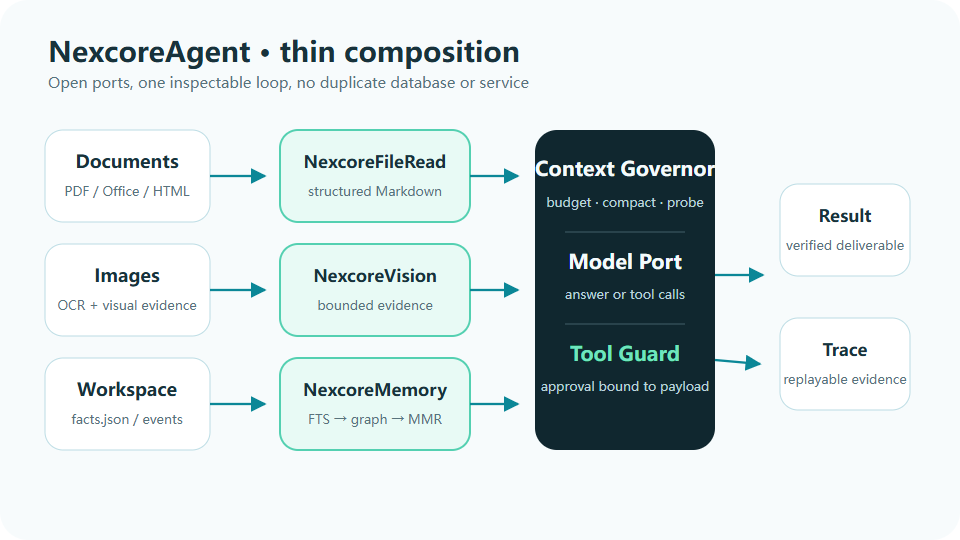

# NexcoreAgent

### 大多数 Agent 框架只负责把模型和工具接起来。  
### 这个框架负责让一次执行看得见、拦得住、追得回。

[](https://github.com/yan-stone-computer/NexcoreAgent/actions/workflows/test.yml)
[](LICENSE)
[](https://nodejs.org/)
[](package.json)



NexcoreAgent 是从 [NexcoreWork](https://github.com/yan-stone-computer/nexcorework-site)
抽出的 **thin agent loop**。它不绑定模型 SDK，不藏一套数据库，也不要求把文件、记忆和视觉能力
搬进同一个巨型进程。

它只做一件重要的事：把下面这条链路固定成可替换的端口。

```text
文件 / 图片
  → NexcoreFileRead / NexcoreVision
  → NexcoreMemory 召回
  → Nexcore Context Governor
  → 模型
  → NexcoreToolGuard 审批
  → 工具 Observation
  → Trace
```

## 为什么你会需要它

普通 agent loop 往往只管：

```text
调用模型 → 解析 tool_calls → 调工具 → 再调用模型
```

到了真实项目，问题会变成：

- 文件太大，什么时候读、读多少？
- 模型看到的记忆来自哪次运行？
- 上下文超预算时，先丢什么？
- 写文件和执行命令前，谁批准？
- 审批过的调用能不能换一个参数复用？
- 工具失败后，模型看到的是什么？
- 用户追问“为什么这么做”时，证据在哪？

NexcoreAgent 不替你实现 OCR、数据库或权限系统。它把这些边界显式接进执行循环，并让每个
端口可以被替换、单测和回放。

## 30 秒看懂

```bash
git clone https://github.com/yan-stone-computer/NexcoreAgent.git
cd NexcoreAgent
npm install
npm run check
```

3 项端到端测试覆盖：

- 文件与记忆先进入上下文；
- 写入工具必须审批，拒绝后不执行副作用；
- 上下文治理拒绝时，模型调用次数为 0。

## 最小用法

```ts
import { NexcoreAgent } from "nexcore-agent";

const agent = new NexcoreAgent({
  model,
  context,
  memory,
  files,
  vision,
  approval,
  trace,
  tools,
});

const result = await agent.run({
  input: "读取 brief.pdf，修改报告，然后验证结果。",
  workspace: "D:/projects/example",
  attachments,
  maxSteps: 20,
});
```

`approval` 没有配置时，写入和执行命令默认拒绝。模型端口只收到工具名、描述和风险等级，
不会收到本机可执行函数。

## 端口，不是枷锁

| Port | What it owns |
|---|---|
| `FileReaderPort` | 将本地文档转换为有界证据 |
| `VisionPort` | 将图片转换为可追溯视觉证据 |
| `MemoryPort` | 工作区内的记忆召回与说明 |
| `ContextPort` | 预算、压缩、拒绝与安全约束 |
| `ModelPort` | 任意模型供应商 |
| `ApprovalPort` | 与具体 payload 绑定的审批 |
| `TracePort` | 事件持久化与后续回放 |

## 与现有项目的关系

NexcoreAgent 是框架层，不复制底层实现：

- [nexcore-context-governor](https://github.com/yan-stone-computer/nexcore-context-governor)
- [NexcoreMemory](https://github.com/yan-stone-computer/NexcoreMemory)
- [NexcoreFileRead](https://github.com/yan-stone-computer/NexcoreFileRead)
- [NexcoreVision](https://github.com/yan-stone-computer/NexcoreVision)
- [NexcoreToolGuard](https://github.com/yan-stone-computer/NexcoreToolGuard)

整套能力在 [NexcoreWork](https://github.com/yan-stone-computer/nexcorework-site)
中运行，并通过 189 项集成测试和 85 项浏览器验收。

## 设计边界

- 串行、可检查优先，不假装成分布式执行平台。
- 不自动重试有副作用的工具。
- 不在框架里保存对话、密钥或业务数据。
- 不在框架里做路径沙箱；工具实现必须自行校验工作区。
- 不把事件持久化伪装成内置能力；`TracePort` 由宿主决定存在哪里。

如果你也在修“Agent 到底做了什么”这个问题，欢迎带着失败案例来开 Issue，或点一个 Star。

## License

MIT
